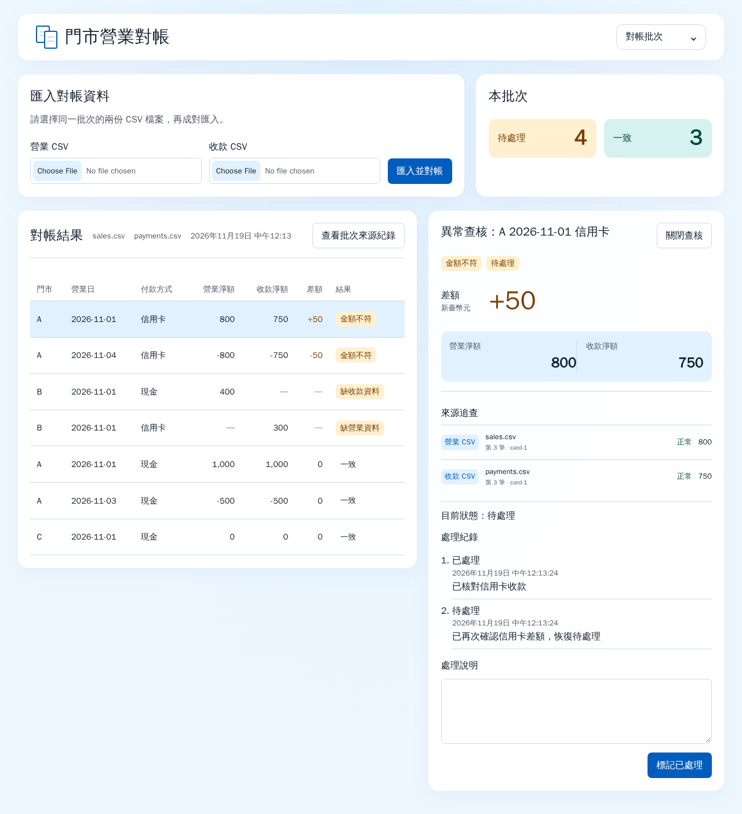

# 餐飲多門市營業資料對帳

一套供總部人員在本機使用的對帳工具。上傳門市的營業與收款資料，即可比較金額、追查來源並留下異常查核紀錄。



## 主要功能

- **CSV 匯入與對帳**　成對匯入營業與收款 CSV，依門市、營業日及付款方式比對金額，標示差額或缺少哪一側的資料。
- **來源追查**　查看分組的原始紀錄，從退款追查原交易，並從批次來源查看取消紀錄。
- **異常查核**　填寫說明後可標記已處理或恢復待處理。每次變更都保留時間和說明，原對帳結果維持原樣。
- **批次管理**　相同內容重開原批次，更正後建立新批次。正常停止再啟動會保留資料。

## 使用技術

| 層面 | 技術 |
| --- | --- |
| 前端 | Vue 3、JavaScript、Vite |
| 後端 | Ruby 3.4、Ruby on Rails 8.1 |
| 資料庫與本機環境 | PostgreSQL 18、Docker Compose |
| 測試 | Minitest、Playwright |

## 本機啟動、停止與重置

在專案根目錄執行。需安裝 Docker 與 Docker Compose。請選用本機 Unix socket 的 Docker context，清除 `DOCKER_HOST`，三項操作都使用同一個 context。

### 啟動

```sh
docker compose -f compose.yaml -p restaurant-reconciliation up -d --build --wait
```

開啟 [本機展示站](http://localhost:3216)。

### 停止

```sh
docker compose -f compose.yaml -p restaurant-reconciliation stop app db
```

停止會保留資料。再次執行啟動指令即可繼續使用。

### 重置展示資料

先啟動本機展示環境。在互動式終端執行下列指令。

```sh
./reset-local-data.sh restaurant-reconciliation
```

核對 Docker context、資料庫及 `restaurant-reconciliation_pgdata` 資料卷後，輸入 `RESET restaurant-reconciliation` 確認，或直接按 Enter 取消。重置會永久清除批次、來源、對帳結果和查核歷史。完成後重新執行啟動指令，樣本可手動匯入。

## 如何測試

連鎖餐飲門市打烊後會交回 POS 營業報表與收款明細。總部隔天比對金額、追查差額，並留下查核紀錄供同事接手。

1. **首次匯入，核對分組與差額。** 選取 [營業 CSV](samples/sales.csv) 與 [收款 CSV](samples/payments.csv)，按「匯入並對帳」應得到七組結果。A 門市 2026-11-01 信用卡應收 800 元、收款 750 元，用已知的 `+50` 確認金額與正負方向。
2. **追查來源，確認查核可交接。** 查看該組的「來源」，再按「查核」，填寫說明標記已處理，接著填原因恢復待處理。應新增兩筆含說明與時間的紀錄，讓接手的人能回看前次處理，原差額仍是 `+50`。
3. **重傳並重啟，確認能繼續查核。** 模擬斷線後重送檔案及隔天接手。匯入相同兩份檔案應開啟原批次，停止並重新啟動後，再從「對帳批次」開啟同一批，確認結果與查核歷史仍在。

Rails 整合測試及 Playwright 瀏覽器測試使用各自的隔離資料庫。查看 [自動化測試指令](docs/project-guide.md#自動化測試)與 [F01–F08 預期結果](docs/operations.md#固定範例預期結果f01f08)。
